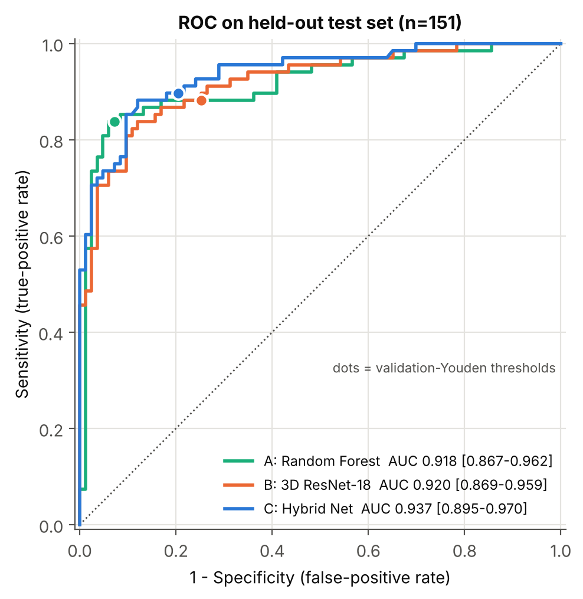
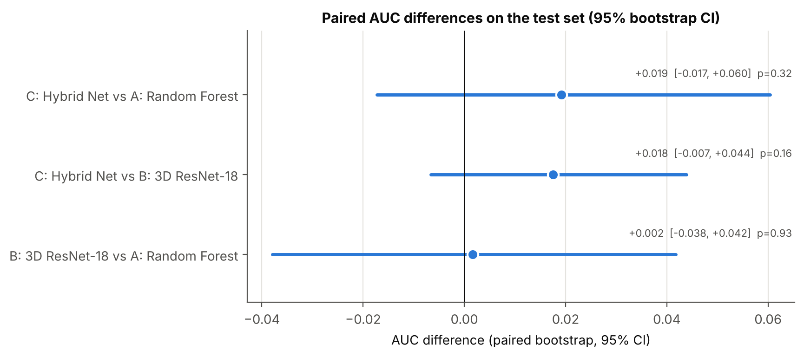
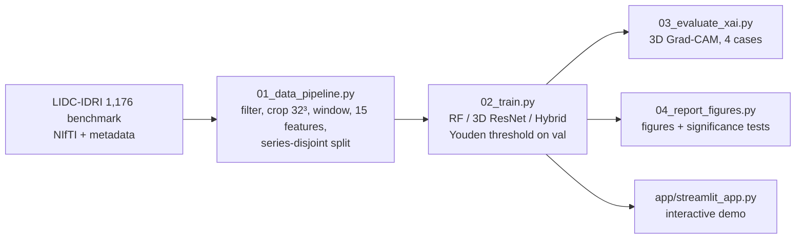
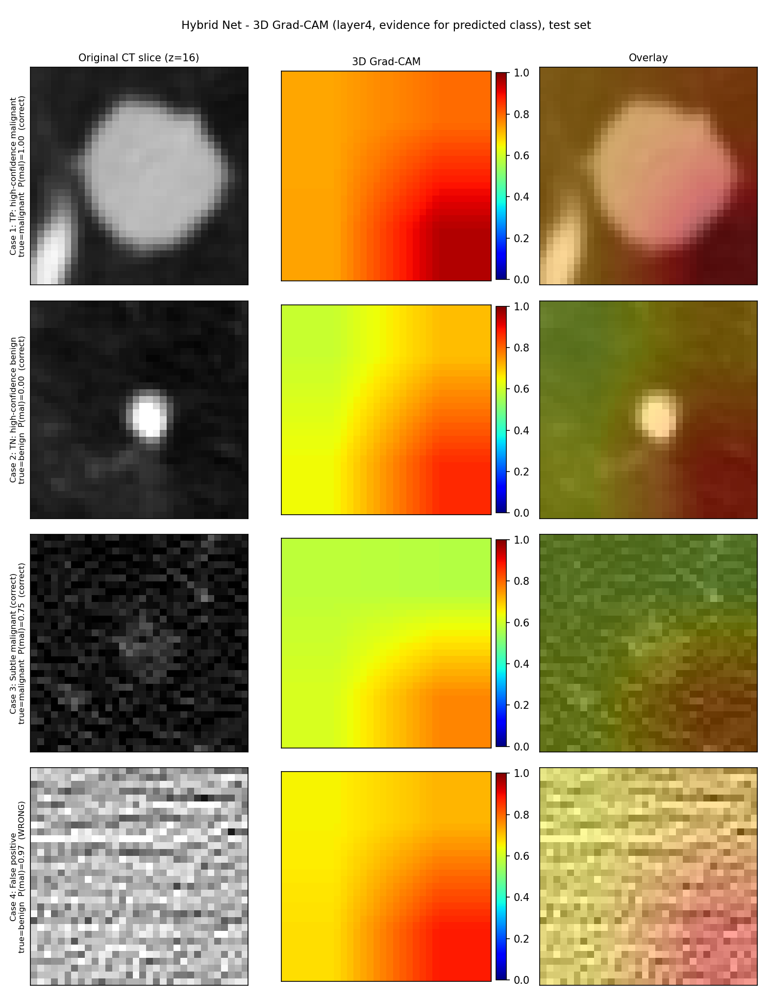

# Hybrid Explainable AI for 3D Lung Nodule Malignancy Prediction

A dual-branch framework that fuses a **3D ResNet-18** (CT patch) with a **tabular radiomics/consensus MLP** through a learned gate, benchmarked against an image-only 3D ResNet-18 and a classical Random Forest, with **3D Grad-CAM** explanations and an interactive **Streamlit** app. Built on the LIDC-IDRI 1,176-nodule benchmark.

> **Research prototype. Not a medical device; not validated for clinical use.**

---

## Key results (held-out test set, n = 151 nodules)

| Model | ROC-AUC (95% CI) | Accuracy | Sensitivity | Specificity | Precision | F1 | FN | FP |
|:--|:-:|:-:|:-:|:-:|:-:|:-:|:-:|:-:|
| A: Balanced Random Forest (tabular) | 0.918 (0.867-0.962) | **0.887** | 0.838 | **0.928** | **0.905** | **0.870** | 11 | **6** |
| B: 3D ResNet-18 (image only) | 0.920 (0.869-0.959) | 0.808 | 0.882 | 0.747 | 0.741 | 0.805 | 8 | 21 |
| C: Hybrid Net (image + radiomics) | **0.937** (0.895-0.970) | 0.841 | **0.897** | 0.795 | 0.782 | 0.836 | **7** | 17 |

Thresholds are chosen by Youden's J on the validation set (A 0.46, B 0.48, C 0.55); the test set is used once, after model selection.

**How to read this honestly**

- The hybrid has the highest AUC and the fewest missed malignancies (7 FN vs 11 for the Random Forest), but its AUC gain is **not statistically distinguishable from zero** (paired bootstrap on the same nodules):

  | Comparison | AUC difference [95% CI] | p (bootstrap) | McNemar p (per-nodule correctness) |
  |:--|:-:|:-:|:-:|
  | C Hybrid vs A Random Forest | +0.019 [-0.017, +0.060] | 0.32 | 0.21 |
  | C Hybrid vs B 3D ResNet | +0.018 [-0.007, +0.044] | 0.16 | 0.23 |
  | B 3D ResNet vs A Random Forest | +0.002 [-0.038, +0.042] | 0.93 | 0.023 |

- The Random Forest is the best model on accuracy, specificity, precision and F1, and is significantly more accurate than the image-only ResNet at the chosen thresholds (McNemar p = 0.023).
- The Random Forest leans on radiologist-rated inputs: **diameter alone carries 47% of its feature importance and the three radiologist-rated features together 60%**. The tabular branch of the hybrid receives the same inputs, so part of any hybrid gain may come from annotator ratings rather than image-derived information (see *Limitations*).
- Single training run (seed 42) on 151 test nodules: the numbers carry real sampling uncertainty.




More figures: [metrics](results/figures/fig_metrics_comparison.png) | [confusion matrices](results/figures/fig_confusion_matrices.png) | [training curves](results/figures/fig_training_curves.png) | [RF importance](results/figures/fig_rf_feature_importance.png) | [probability distributions](results/figures/fig_probability_distributions.png) | [dataset splits](results/figures/fig_dataset_splits.png). Full tables: `results/model_comparison_metrics.csv`, `results/figures/significance_tests.csv`.

---

## Pipeline



### 1. Data (Day 1)
- 1,176 nodule sub-volumes (`128 x 128 x 64`) with radiologist consensus metadata. Nodules with mean malignancy score **= 3.0 are excluded** (176), leaving **1,000** (554 benign `< 3`, 446 malignant `> 3`).
- Volumes are transposed to `(D, H, W)`, centre-cropped to `32 x 32 x 32` (pad -1000 HU), clipped to `[-1000, 400]` HU and min-max scaled to `[0, 1]`.
- **15 tabular features**: 10 intensity statistics (mean, std, min, max, median, P25, P75, IQR, skewness, kurtosis), 2 tissue densities (solid fraction `> -400` HU, hyperdense fraction `> 100` HU) and 3 radiologist consensus values (mean diameter, calcification, texture).
- `GroupShuffleSplit` grouped by `SeriesInstanceUID` (546 series; best of 100 seeds for class balance, seed 60); zero series overlap across splits:

| Split | Nodules | Benign | Malignant | Malignant % | Series |
|:--|:-:|:-:|:-:|:-:|:-:|
| Train | 703 | 389 | 314 | 44.7% | 382 |
| Validation | 146 | 82 | 64 | 43.8% | 82 |
| Test | 151 | 83 | 68 | 45.0% | 82 |

### 2. Models (Day 2)
- **A - Random Forest**: 150 trees, `max_depth=6`, `class_weight='balanced'`, on the raw 15 features.
- **B - Pure 3D ResNet-18**: torchvision `r3d_18`, 1-channel stem, `512 -> 128` embedding, head `128 -> 64 -> 1`.
- **C - Hybrid Net**: the same visual encoder and head, plus a tabular MLP `15 -> 64 -> 64` (BatchNorm, GELU, dropout 0.2) and a **gated fusion**
  `gate = sigmoid(W[z_v ; z_t])`, `z = gate * z_v + (1 - gate) * W_t z_t`. Tabular features are standardised with **train-set statistics only**.
- Training (B and C): `BCEWithLogitsLoss` with `pos_weight = 389/314 = 1.239`, AdamW (lr 1e-4, wd 1e-4), `ReduceLROnPlateau` on validation AUC (factor 0.5, patience 5), 40 epochs, batch 32, bf16 autocast, random 3D flips + in-plane 90-degree rotations. The best-validation-AUC epoch is kept (B: epoch 14, val AUC 0.915; C: epoch 19, val AUC 0.923). Trained on an NVIDIA H200 NVL.

### 3. Explainability
3D Grad-CAM on the last residual block of `layer4` of the hybrid's CNN branch (`--target-layer layer3` for a finer 8x4x4 map), explaining the model's predicted class.



| Case | Selection rule | True | P(malignant) | Diameter | Outcome |
|:--|:--|:-:|:-:|:-:|:--|
| 1 | Highest-confidence true positive | malignant | 1.000 | 17.9 mm | correct |
| 2 | Highest-confidence true negative | benign | 0.002 | 7.5 mm | correct |
| 3 | Smallest-diameter true positive | malignant | 0.752 | 8.3 mm | correct |
| 4 | Highest-confidence false positive | benign | 0.967 | 5.4 mm | wrong (mean radiologist score 2.67) |

**Important caveat.** At 32^3 input the `layer4` map is only `4 x 2 x 2`, and in all four cases the CAM peak lands on essentially the same voxel (`[., 24, 24]`). The share of CAM mass inside the central `16^3` cube is 0.14-0.17 against 0.125 for a perfectly uniform map ([figure](results/figures/fig_cam_localization.png)). An exploratory check at `layer3` gave 0.08, 0.37, 0.09 and 0.12 for the same cases, with no consistent concentration on the nodule either. **These heatmaps are qualitative and do not demonstrate that the network attends to the nodule.** Grad-CAM also explains only the CNN branch, not the tabular branch.

---

## Limitations

1. **Scope: classification, not detection.** The benchmark contains patches centred on radiologist-annotated nodules; no nodule detection in full scans is performed.
2. **Annotator-derived inputs.** Diameter, calcification and texture are radiologist ratings produced alongside the malignancy score. An ablation without them (image-derived features only) is still needed to separate genuine image signal from annotator information.
3. **No significant advantage for the hybrid** over the baselines on this test set (see the table above).
4. **Labels are consensus ratings, not pathology.** Malignancy is the mean of up to four radiologists' 1-5 scores; a nodule with a mean of 2.67 is labelled benign (case 4 above).
5. **Series-level, not patient-level, splitting.** The metadata has no PatientID, so a patient with several scans could straddle splits.
6. **Single run, single dataset.** One seed, no cross-validation, no external validation, no calibration analysis.
7. **Grad-CAM resolution** (see above).

## Repository structure

```text
2026-hybrid-nodule-v2/
├── 01_data_pipeline.py            # Day 1: ingestion, preprocessing, radiomics, splits, self-check
├── models/
│   ├── hybrid_net.py              # HybridNoduleNet, Pure3DResNet
│   ├── baseline_rf.py             # Balanced Random Forest baseline
│   └── gradcam.py                 # 3D Grad-CAM (used by the XAI script and the app)
├── pipelines/
│   ├── common.py                  # dataset, augmentation, scaler, metrics
│   ├── 02_train.py                # A/B/C training + benchmark
│   ├── 03_evaluate_xai.py         # Grad-CAM cases -> figure + audit JSON
│   └── 04_report_figures.py       # report figures + significance tests
├── app/streamlit_app.py           # interactive demo
├── data/{raw,processed}/          # raw is git-ignored; processed holds patches + CSV manifests
├── results/                       # checkpoints, metrics, figures, audit (checkpoints git-ignored)
└── requirements.txt
```

## Reproduce

```bash
pip install -r requirements.txt

python 01_data_pipeline.py            # Day 1 (needs data/raw/LIDC-IDRI + LIDC-IDRI_1176.npy)
python pipelines/02_train.py          # trains A/B/C, writes results/ (needs a CUDA GPU; --allow-cpu for debugging)
python pipelines/03_evaluate_xai.py   # Grad-CAM figure + audit  (--target-layer layer3 optional)
python pipelines/04_report_figures.py # figures + significance tests (CPU only)
```

## Interactive app

```bash
streamlit run app/streamlit_app.py
# remote GPU server:  streamlit run app/streamlit_app.py --server.port 8501 --server.headless true
#                     ssh -L 8501:localhost:8501 <user>@<server>   ->  http://localhost:8501
```

Tabs: **Test-set explorer** (pick any test nodule or filter by hybrid TP/TN/FP/FN, compare the three models' probabilities, browse axial/coronal/sagittal slices with Grad-CAM overlay at `layer4`/`layer3`), **Custom input** (upload a `32x32x32` `.npy` patch + enter the 15 features), **Model performance** (tables and figures) and **About & limitations**. It needs `results/best_hybrid_net.pth`, `results/best_pure_resnet.pth` and `results/baseline_rf.joblib` (checkpoints are ~133 MB each and are not stored in git); set `NODULE_RESULTS_DIR` / `NODULE_DATA_DIR` to use other locations.

## Data and references

- **LIDC-IDRI**: Armato SG III et al., *Medical Physics* 38(2):915-931, 2011; hosted by The Cancer Imaging Archive (Clark K et al., *J Digit Imaging* 26(6):1045-1057, 2013). <https://www.cancerimagingarchive.net/collection/lidc-idri/>
- **1,176-nodule benchmark**: LUNA22-ISMI release of LIDC-IDRI nodules, <https://zenodo.org/record/6559584> (CC BY 4.0).
- **3D ResNet-18 (`r3d_18`)**: Tran D et al., *A Closer Look at Spatiotemporal Convolutions for Action Recognition*, CVPR 2018.
- **Grad-CAM**: Selvaraju RR et al., *Grad-CAM: Visual Explanations from Deep Networks via Gradient-based Localization*, ICCV 2017.
