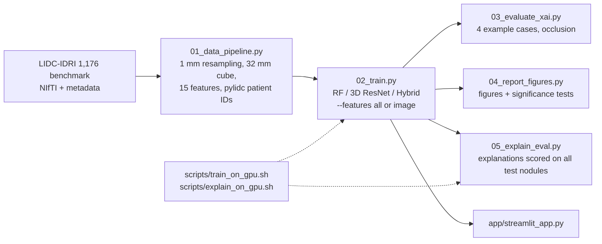

# Hybrid Explainable AI for 3D Lung Nodule Malignancy Prediction

A dual-branch model that fuses a **3D ResNet-18** (CT patch) with a **tabular MLP** (15 features) through a learned gate. It is benchmarked against an image-only 3D ResNet-18 and a classical Random Forest, with **occlusion and Grad-CAM explanations scored on every test nodule**, and an interactive **Streamlit** app. Built on the LIDC-IDRI 1,176-nodule benchmark.

> **Research prototype. Not a medical device; not validated for clinical use.**
> Labels are radiologists' malignancy ratings, not biopsy results.

---

## Key results (held-out test set, 151 nodules, 5 training seeds)

Patches resampled to 1 mm voxels, patient-disjoint split, every model trained 5 times (seeds 42–46). Run `results/phase7_R`, which replicates `results/phase7_A`.

| Inputs | Model | Test AUC, mean ± SD over seeds | 5-seed ensemble AUC [95% CI] |
|:--|:--|:-:|:-:|
| all 15 features | A: Random Forest | 0.942 ± 0.004 | 0.943 [0.900, 0.980] |
| all 15 features | B: 3D ResNet-18 (image only) | 0.897 ± 0.011 | 0.907 [0.856, 0.953] |
| all 15 features | C: Hybrid | 0.909 ± 0.015 | 0.923 [0.875, 0.962] |
| **12 image features only** | A: Random Forest | **0.666** ± 0.010 | 0.668 [0.573, 0.754] |
| **12 image features only** | B: 3D ResNet-18 | **0.901** ± 0.011 | 0.913 [0.860, 0.957] |
| **12 image features only** | C: Hybrid | **0.901** ± 0.015 | 0.915 [0.862, 0.961] |

Reference models with no training randomness: **diameter alone 0.941** [0.897, 0.974]; logistic regression on the 3 radiologist ratings **0.969** [0.941, 0.991]; logistic regression on the 12 image features 0.641 [0.550, 0.729].

**How to read this honestly**

- **Three of the 15 features are radiologist ratings** (diameter, calcification, texture), made by the same readers who gave the malignancy label. With them, everything looks strong; the 3-rating logistic regression beats every model. That number is circular.
- **Without the ratings, the Random Forest collapses** (0.942 → 0.666; ensemble difference +0.276 [+0.197, +0.364], 5/5 seeds). It was mostly reading the answer key.
- **The deep models learn from the CT image.** Without the ratings, the Hybrid changes by +0.008 [−0.005, +0.022] (p = 0.25). That is within the noise of the image-only ResNet control (−0.006).
- **The Hybrid is not better than the image-only ResNet** (0.901 vs 0.901 with image features). Shuffling its feature table between nodules costs only 0.03 AUC; shuffling the images costs 0.32. The fusion gate passes almost nothing from the table (*modality imbalance*).
- **One training run moves by about ±0.01 AUC by chance.** The same Hybrid with seed 42, trained three times, scored 0.912 / 0.930 / 0.919, because GPU training is not bit-reproducible. So results are reported as mean ± SD over seeds.
- **The headline:** from the CT image alone, the models reach **about 0.90 AUC** against radiologist consensus labels. This agrees with published LIDC findings that nodule size alone is a strong baseline ([Pitfalls of Sample Selection, 2021](https://arxiv.org/abs/2108.05386)) and that LIDC labels carry reader bias ([Re-thinking and Re-labeling LIDC-IDRI, 2022](https://arxiv.org/abs/2207.14238)).
- **Earlier claim superseded:** Part 2 reported a Hybrid AUC of 0.937 from one run on un-resampled patches. The 5-seed results above do not support it (see the Phase 7 notes in `docs/PHASE_7_decisions.md`).

Full tables: `results/phase7_R/SUMMARY.md` (accuracy) and `results/phase7_R/EXPLAIN_SUMMARY.md` (explanations).

---

## Explanations, scored on all 151 test nodules

Each heat map is scored against a ball with the nodule's diameter at the patch centre (`models/xai_metrics.py`):

- **Concentration** is the share of heat on the nodule divided by the share of the cube it fills, where 1.0 means a flat map.
- **Hit** means the hottest point lies on the nodule.
- The trivial *centre prior*, a blob that always lights the centre, is the bar to compare against.

| Hybrid (all features), 5 seeds | Concentration (1 = flat) | Hit rate | Centre of heat → nodule centre |
|:--|:-:|:-:|:-:|
| Grad-CAM layer4 (Part 2 method, 4×2×2) | 1.23 | 15% | 3.0 mm |
| same network with **random weights** (sanity check) | 1.11 | 27% | 6.6 mm |
| Grad-CAM layer3 (8×4×4) | 1.83 | 38% | 5.7 mm |
| **Occlusion** (8 mm cube, stride 4 mm) | **2.24** | ≥ 52%\* | **2.5 mm** |
| centre prior (trivial reference) | 8.40 | 100% | 0.0 mm |

\* Occlusion maps have flat 4 mm plateaus. The first scoring used `argmax`, which picks a plateau corner, so occlusion hit rates were **understated**. The bug was found by a unit test and fixed on 30 Oct 2026; the re-score is pending (`FORCE=1 bash scripts/explain_on_gpu.sh phase7_R`). Concentration and distance were not affected.

- **Layer4 Grad-CAM (the method used in Part 2) scores like an untrained network**, so it does not explain the model.
- **Occlusion localises best** and is now the default (`pipelines/03_evaluate_xai.py`, the app). Most heat still spreads into the surrounding tissue, because an 8 mm occluder is about the size of the median nodule (9 mm).
- **Sanity check passed:** rank correlation between trained and random-weights maps is −0.02 to 0.16.

---

## Pipeline



### 1. Data
- 1,176 nodule sub-volumes (`64 × 128 × 128`) with radiologist consensus metadata. Nodules with mean malignancy **= 3.0 are excluded** (176), leaving **1,000**: 554 benign (`< 3`) and 446 malignant (`> 3`).
- **Resampling:** every patch is resampled to **1 mm isotropic** voxels and cropped to a **32 mm cube** (32³) around the nodule, with trilinear interpolation.
  - Before this, the 32-voxel crop covered 14–80 mm in depth depending on the scanner's slice gap (0.45–2.5 mm).
  - 4 patches need padding (the 0.45 mm scans), and 28 nodules larger than 32 mm are cut at the edge.
- Values are clipped to `[−1000, 400]` HU and scaled to `[0, 1]`.
- **15 tabular features:**
  - 10 intensity statistics
  - 2 density fractions (solid `> −400` HU, hyperdense `> 100` HU)
  - 3 radiologist ratings: diameter, calcification, texture
- **Patient-disjoint split:** patient IDs come from **pylidc**'s annotation database (546 series → **545 patients**). The pipeline fails if a patient appears in two splits.

| Split | Nodules | Benign | Malignant | Malignant % | Patients |
|:--|:-:|:-:|:-:|:-:|:-:|
| Train | 703 | 389 | 314 | 44.7% | 381 |
| Validation | 146 | 82 | 64 | 43.8% | 82 |
| Test | 151 | 83 | 68 | 45.0% | 82 |

### 2. Models
- **A: Random Forest.** 150 trees, `max_depth=6`, `class_weight='balanced'`.
- **B: 3D ResNet-18.** torchvision `r3d_18` with a 1-channel stem, a `512 → 128` embedding and a `128 → 64 → 1` head (33.2 M weights).
- **C: Hybrid.** The same image encoder, plus a tabular MLP (`n → 64 → 64`), joined by a **gated fusion**: `gate = sigmoid(W[z_v ; z_t])` and `z = gate · z_v + (1 − gate) · W_t z_t`.
- **Training (B and C):**
  - `BCEWithLogitsLoss` with `pos_weight = 389/314`
  - AdamW (lr 1e-4, wd 1e-4) and `ReduceLROnPlateau` on validation AUC
  - 40 epochs, batch 32, bf16 on CUDA
  - Random flips and in-plane 90° rotations
  - The best-validation-AUC epoch is kept, and thresholds come from validation (Youden's J)
- **Ablation:** `--features image` gives the RF and Hybrid only the 12 CT-derived features.

---

## Limitations

1. **Classification, not detection.** Patches are centred on annotated nodules; nodules are not found in full scans.
2. **Labels are radiologists' opinions**, not pathology. 333 of 1,000 nodules have a mean score between 2.5 and 3.5, where one reader's vote flips the label.
3. **Radiologist-rated inputs are circular.** Results with the 3 ratings overstate what the image shows.
4. **Modality imbalance.** The Hybrid's table branch is almost unused, so the fusion adds no measurable benefit.
5. **Explanations localise the nodule only about half the time.** Grad-CAM layer4 fails the sanity comparison.
6. **Probabilities are not calibrated.** The Hybrid is over-confident: Brier 0.151 vs 0.096 for the RF in run 1.
7. **One dataset, no external validation.** The test set was looked at during Phase 7, so future model choices are made on validation only.
8. **Whole-cube radiomics.** The 12 image features use the whole 32 mm cube with no nodule mask, which is why they are weak (0.641 in a logistic regression).

## Repository structure

```text
2026-hybrid-nodule-v2/
├── 01_data_pipeline.py           # ingestion, 1 mm resampling, features, pylidc patient IDs, split, self-check
├── models/
│   ├── hybrid_net.py             # HybridNoduleNet, Pure3DResNet
│   ├── baseline_rf.py            # Balanced Random Forest
│   ├── gradcam.py                # 3D Grad-CAM + occlusion maps (used by scripts and the app)
│   └── xai_metrics.py            # ball-mask scoring of heat maps
├── pipelines/
│   ├── common.py                 # dataset, feature sets, device (CUDA -> Apple MPS -> CPU), metrics
│   ├── 02_train.py               # A/B/C training + benchmark (--features all|image, --seed)
│   ├── 03_evaluate_xai.py        # 4 example cases (occlusion by default)
│   ├── 04_report_figures.py      # report figures + significance tests
│   └── 05_explain_eval.py        # explanations scored on all test nodules + sanity + dependence
├── scripts/
│   ├── train_on_gpu.sh           # feature sets x seeds -> results/<run>/, then aggregate_runs.py
│   ├── explain_on_gpu.sh         # 05 for every seed, then aggregate_explain.py
│   └── phase7_resampling_stats.py
├── tests/                        # pytest, CPU only
├── docs/                         # PROJECT_MAP.md, PHASE_7*.md (decisions log), figures
├── app/streamlit_app.py
├── data/{raw,processed}/         # raw is git-ignored; processed holds patches + CSV manifests
└── results/<run>/<features>/seed_<n>/   # metrics, predictions, figures (checkpoints git-ignored)
```

## Reproduce

```bash
pip install -r requirements.txt
python -m pytest tests/ -q                               # CPU checks

python 01_data_pipeline.py --no-download                 # data (needs data/raw/LIDC-IDRI + LIDC-IDRI_1176.npy)

# GPU server (one H200): 2 feature sets x 5 seeds, then explanation scores
GPU=0 bash scripts/train_on_gpu.sh phase7_R              # ~12 min
GPU=0 bash scripts/explain_on_gpu.sh phase7_R            # ~10 min

# MacBook (Apple MPS if it works, else CPU): small smoke run
python pipelines/02_train.py --allow-cpu --limit 64 --epochs 2 --num-workers 0 --results-dir /tmp/mac
```

## Interactive app

```bash
NODULE_RESULTS_DIR=results/phase7_R/all/seed_42 streamlit run app/streamlit_app.py
# remote GPU server:  ... --server.port 8642 --server.headless true
#                     ssh -L 8642:localhost:8642 <user>@<server>   ->  http://localhost:8642
```

The app has four tabs:
- **Test-set explorer:** pick a nodule, compare the three models, and view occlusion or Grad-CAM maps with their nodule score.
- **Custom input**
- **Model performance**
- **About & limitations**

The app needs a run trained with all 15 features (checkpoints are about 133 MB each and are not stored in git).

## Data and references

- **LIDC-IDRI:** Armato SG III et al., *Medical Physics* 38(2):915–931, 2011.
  - **Data citation:** Armato SG III et al. (2015). Data From LIDC-IDRI [Data set]. The Cancer Imaging Archive. **https://doi.org/10.7937/K9/TCIA.2015.LO9QL9SX**
  - TCIA: Clark K et al., *J Digit Imaging* 26(6):1045–1057, 2013.
- **1,176-nodule benchmark:** the LUNA22-ISMI release of LIDC-IDRI nodules, <https://zenodo.org/record/6559584> (CC BY 4.0).
- **pylidc:** Hancock MC, Magnan JF, *J Med Imaging* 3(4):044504, 2016.
- **3D ResNet-18 (`r3d_18`):** Tran D et al., CVPR 2018.
- **Grad-CAM:** Selvaraju RR et al., ICCV 2017.
- **Occlusion sensitivity:** Zeiler MD, Fergus R, ECCV 2014.
- **Sanity checks for saliency maps:** Adebayo J et al., NeurIPS 2018.
- **Related LIDC findings:**
  - *The Pitfalls of Sample Selection: A Case Study on Lung Nodule Classification*, 2021, <https://arxiv.org/abs/2108.05386>
  - *Re-thinking and Re-labeling LIDC-IDRI for Robust Pulmonary Cancer Prediction*, 2022, <https://arxiv.org/abs/2207.14238>

## Credits

Built by Shrinkhal, with **Claude** (Anthropic) as a coding assistant.
